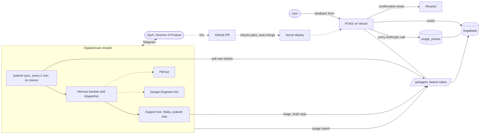
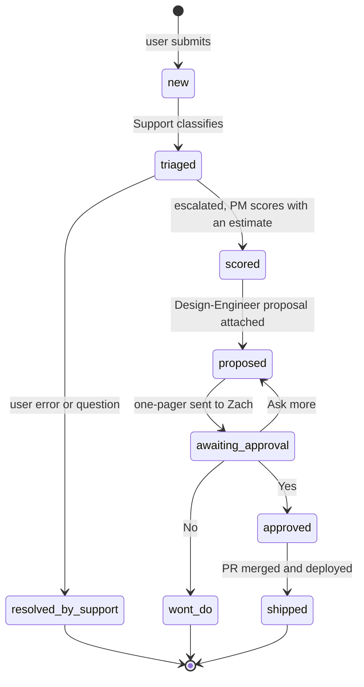
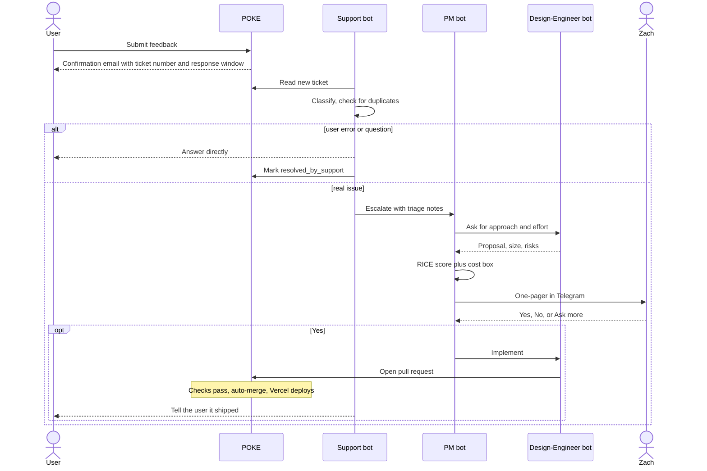

# POKE agent team: architecture

Three diagrams. They render on GitHub. Roles and rules are in [PRD.md](PRD.md).

## 1. The big picture

Solid arrows exist today (Phases 1 and 2). Dashed arrows are planned.

## 2. Life of a ticket

## 3. From feedback to shipped

