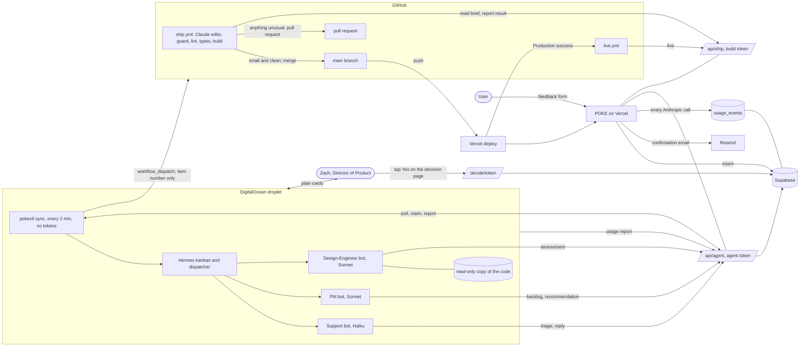
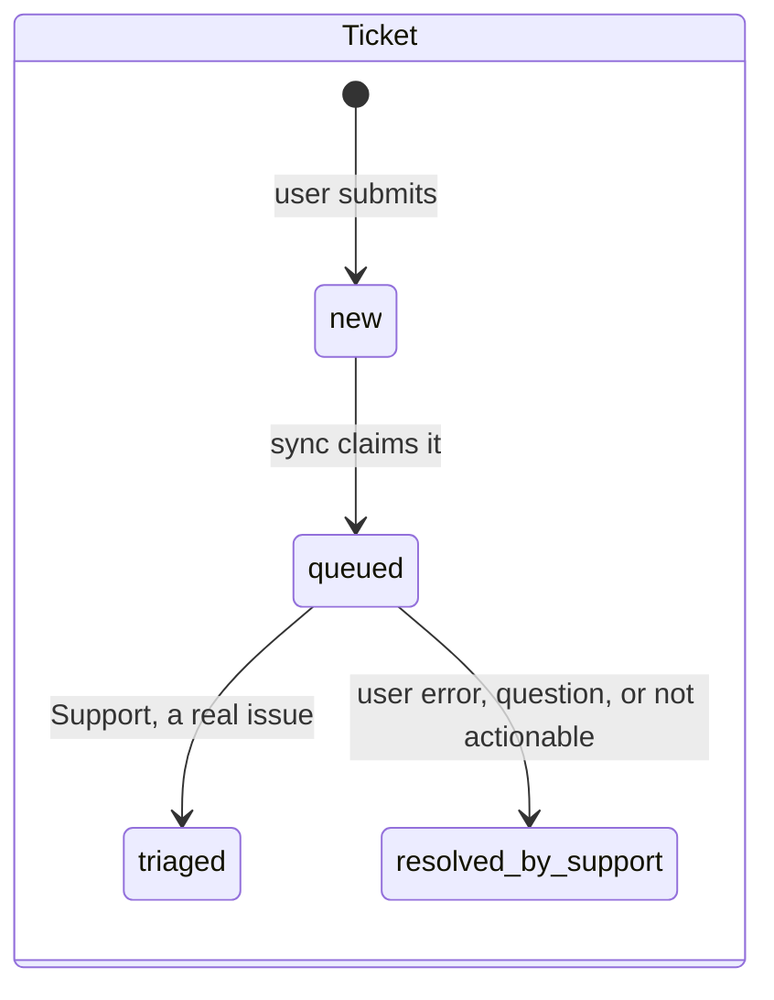
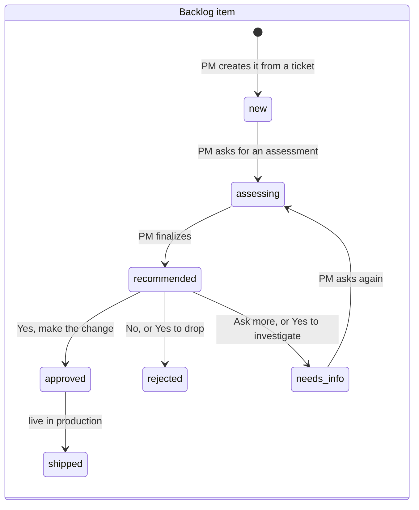
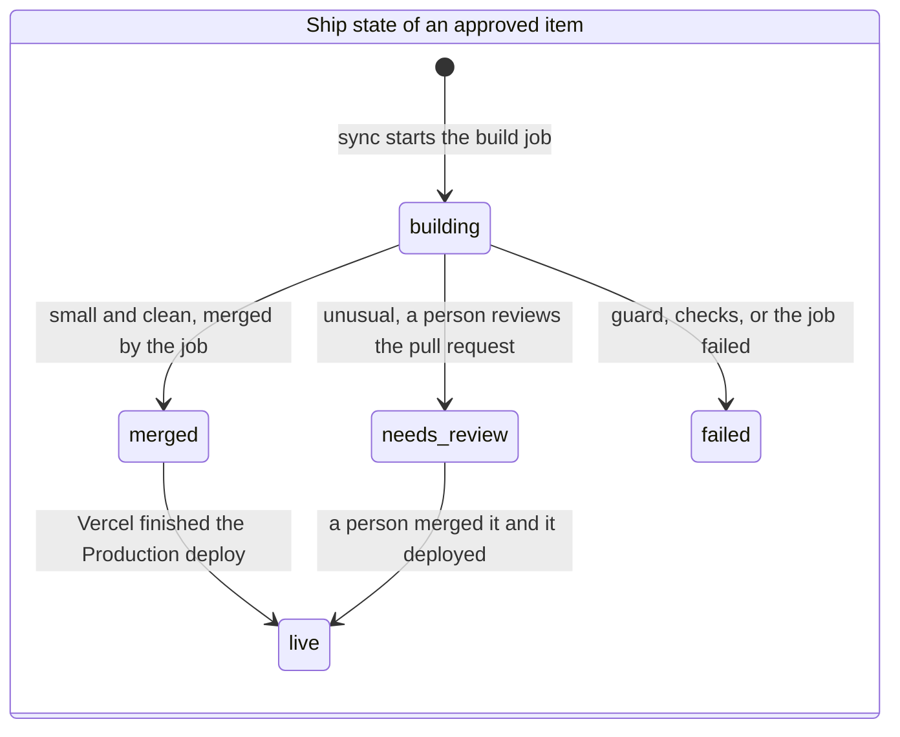
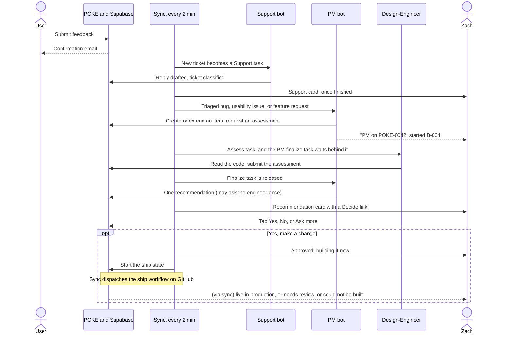
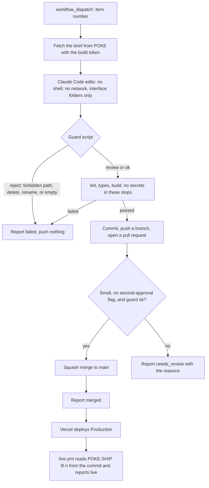

# POKE agent team: architecture

Four diagrams. They render on GitHub. Roles and rules are in [PRD.md](PRD.md), commands are in
[runbook.md](runbook.md). Everything shown with a solid arrow exists and has run in production.

## 1. The big picture

## 2. Three state machines

A feedback **ticket** belongs to Support. It becomes a backlog **item** once the PM takes it. An
approved item then has a **ship** state.

## 3. From feedback to live, with the real hops

Each arrow between agents waits for the next 2 minute sync, which is why the whole trip takes minutes.

## 4. Inside the build job

